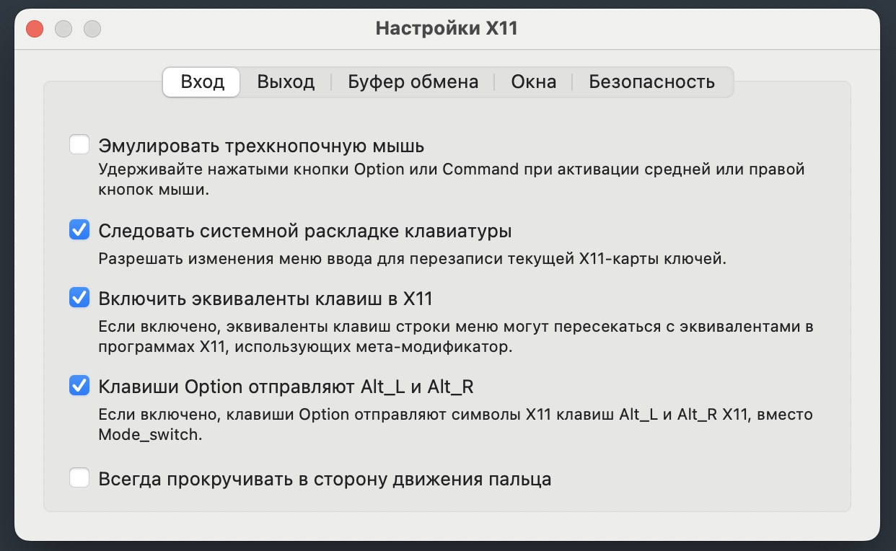
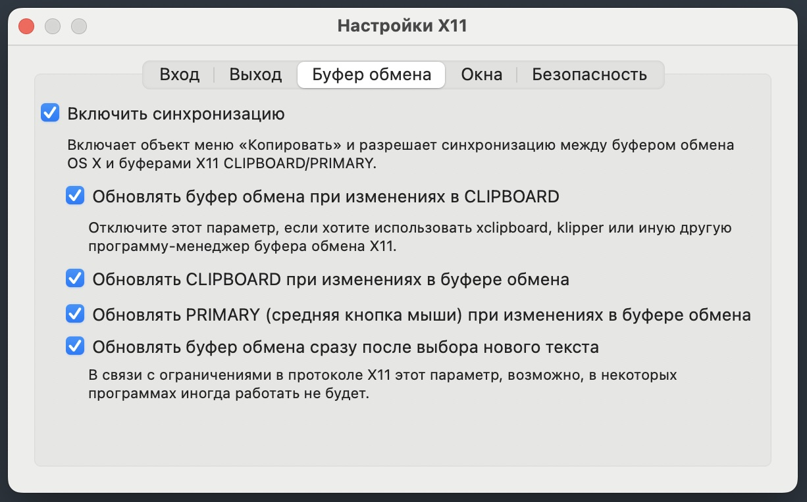
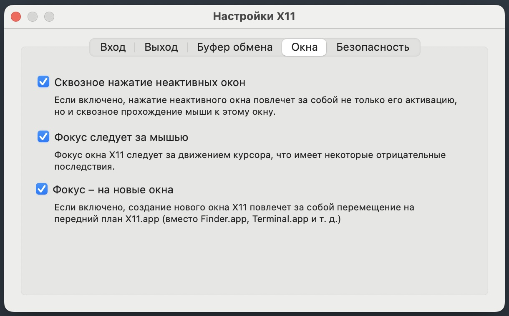
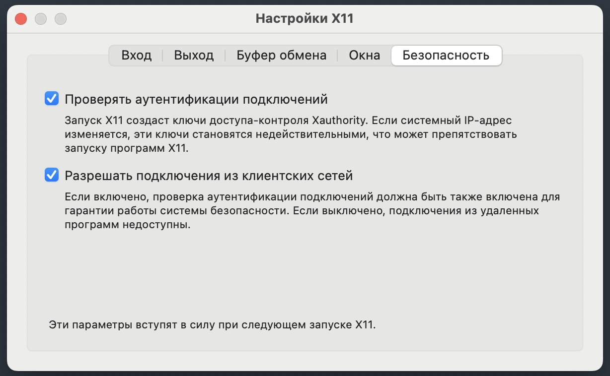

# XQuartz preferences

The container connects to XQuartz over TCP (`host.docker.internal:0`) and authenticates with the XQuartz cookie, which `idea.sh` copies into the container on every start. Two options on the **Security** tab are required:

* **Authenticate connections**: XQuartz creates the cookie. Clients without it are rejected.
* **Allow connections from network clients**: XQuartz listens on TCP.

Restart XQuartz after changing them. Without a cookie `idea.sh` falls back to `xhost +localhost`, which lets any local process, including any container, connect to the display.

